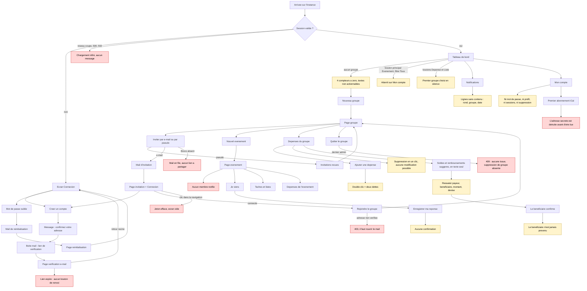

# Audit UI / UX / architecture frontend — Attroupe

Date : 18 novembre 2026 · Branche `beta` (HEAD `70c20a1`) · **Audit en lecture seule : aucun fichier
de l'application n'a été modifié.** Ce rapport est le seul document produit.

Périmètre couvert : les 3384 lignes de `styles.css`, `index.html`, le manifeste et le service worker,
les 23 vues et 8 composants du client, la coque et le routage, les 1 000 lignes de `i18n/fr.json`,
les modules `api/*`, et la comparaison avec les routes du serveur.
Méthode : quatre audits parallèles (design system, vues lourdes, vues restantes, parcours et manques),
puis recoupement et vérification des constats les plus graves directement dans le code.

Les chemins sont relatifs à `app/client/src/` sauf mention contraire.
`css:N` désigne une ligne de `styles.css`, `fr:N` une ligne de `i18n/fr.json`.

---

## 1. Synthèse exécutive

### Notes par axe

| Axe | Note | Résumé en une phrase |
|---|---|---|
| Ergonomie et heuristiques | **4,5 / 10** | Les écritures n'ont ni garde, ni retour de réussite, ni confirmation fiable. |
| UI et direction artistique | **5 / 10** | Identité cohérente et plaisante, mais aucun système : 21 tokens contre 81 couleurs en dur. |
| Parcours et architecture de l'information | **5 / 10** | Routes profondes partageables, mais pas de 404, pas de titre, et plusieurs impasses. |
| Onboarding et découvrabilité | **4 / 10** | Le nouvel utilisateur voit quatre compteurs à zéro et un bouton principal qui l'envoie ailleurs. |
| Responsive et mobile | **6,5 / 10** | Les fondations sont saines (viewport, 16 px, safe-area, 44 px) ; la tablette et le sticky cassent. |
| Accessibilité (WCAG 2.1 AA) | **4 / 10** | Focus clavier invisible sur les cases, 12 contrastes sous le seuil, zéro `aria-live` actif. |
| Microcopy et UX writing | **4,5 / 10** | Boutons nus, jargon technique exposé, zéro espace insécable et zéro apostrophe courbe. |
| Architecture frontend | **4,5 / 10** | Le même schéma de chargement réécrit 56 fois, aucun contexte partagé, composants de 1 000 lignes. |
| Complétude fonctionnelle | **6 / 10** | Le cœur de la V1 est là ; dix capacités du serveur n'ont aucune porte d'entrée. |
| **Global** | **5 / 10** | Un produit dont les fonctions existent et dont la couche d'usage n'est pas finie. |

### Forces réelles, à ne pas casser

1. **Le routage par fragment est plus solide qu'il n'y paraît.** Événement, liste, sondage et fil ont
   chacun leur route (`App.tsx:67-98`) ; un lien profond survit à la connexion ; le `key={route.id}`
   (`App.tsx:420`, `435`) remonte les composants au changement de groupe, ce qui empêche toute fuite
   d'état d'un groupe à l'autre. Le cloisonnement se tient aussi côté interface.
2. **Les liens à jeton sont bien conçus.** Jeton dans le fragment, jamais dans un journal d'accès,
   effacé dès lecture (`lien.ts`, `historique.ts`), chemins verrouillés par un test.
3. **La PWA est complète** : manifeste correct, service worker qui met la coquille en cache, exclut
   `/api/`, `/ical/` et `/media/`, gère le push et la navigation au clic (`public/sw.js`).
4. **Les fondations mobiles sont bonnes** : `viewport-fit=cover` sans `maximum-scale`, champs à
   `font-size: 1rem` (donc pas de zoom iOS), `min-height: 2.75rem` sur les boutons,
   `minmax(0, 1fr)` systématique, `safe-area-inset-bottom` compensée, `overflow-wrap: anywhere` sur
   les libellés de contenu.
5. **Trois endroits font tout bien** : `Connexion.tsx`, `Reinitialisation.tsx` et le formulaire de
   `CarteSourcesAgenda.tsx` ont un garde de double envoi par `ref`, un libellé de progression et un
   `finally`. La carte avatar de `Compte.tsx:410-492` est le modèle à généraliser. `useRechargement`
   a une garde de génération correcte.
6. **Un point d'inquiétude écarté par le calcul** : `--texte-doux` (`#475569`) sur le verre à 72 %
   donne 6,98 à 7,34:1, y compris sous les pics des dégradés radiaux. Le glassmorphisme ne nuit pas
   à la lisibilité du texte secondaire.

### Les cinq faiblesses les plus critiques

1. **Les erreurs sont invisibles.** `Erreur.tsx:11` rend `
` sans classe ; la classe
   `.erreur` (css:772) n'est référencée par aucun TSX et aucune règle ne cible `[role=alert]`. Les
   ~70 messages d'erreur de l'application ont donc l'apparence du texte courant. Pire,
   `Erreur.tsx:7` passe `'erreur.interne'` à `texteErreur`, qui cherche `erreur.erreur.interne` —
   clé absente de `fr.json` — si bien que toute erreur non portée par une clé serveur affiche le
   repli générique par accident. Toute la gestion d'erreur écrite dans les 31 fichiers est annulée
   par ces deux lignes.
2. **Une action d'écriture sur deux peut partir deux fois.** Aucun garde ni état d'envoi sur
   14 chemins : création de groupe, d'événement, de sondage, de liste, de fil, de message, d'album,
   de tâche, **de dépense et de règlement**, vote de sondage, réponse de présence, acceptation
   d'invitation. Un double clic crée deux dépenses identiques, donc deux dettes.
3. **Des destructions irréversibles en un clic, et rien à modifier.** Une dépense se supprime sans
   confirmation (`Depenses.tsx:580-593`) et ne se modifie pas, alors que `PATCH /depenses/:id`
   existe côté serveur : une faute de frappe se corrige en détruisant une donnée financière
   partagée. Même chose pour un créneau de sondage et tous ses votes (`Sondage.tsx:207-215`), un
   article de liste collé au bouton « Je prends » (`Liste.tsx:197-204`), la conversion d'un sondage.
   Les huit confirmations qui existent sont des `window.confirm` natifs, dont deux absurdes :
   « Annuler cet événement ? » avec un bouton « Annuler » qui veut dire « ne pas annuler ».
4. **L'application sait se bloquer sur « Chargement… ».** Toute erreur autre qu'un 401 sur
   `/api/moi` au démarrage laisse l'état à `chargement` sans message ni reprise
   (`App.tsx:127-137`, `156`) : c'est l'expérience hors ligne par défaut, alors que le service
   worker sert bien la coquille. Le même défaut existe sur quatre écrans internes, auquel
   s'ajoutent cinq pages blanches pendant le chargement et cinq faux états vides.
5. **Le premier contact est cassé à trois endroits.** Le bouton principal du tableau de bord,
   « Événement », mène à « Mon compte » dès que le filtre vaut « Tous les groupes »
   (`TableauDeBord.tsx:217-218`). L'invité sans compte perd le jeton de son invitation pendant la
   confirmation d'adresse, et aucun écran ne permet de redemander le lien, bien que
   `POST /api/moi/email/verification` existe et que deux textes le promettent. Et seuls les
   **messages** déclenchent une notification : `services/fils.ts:57` est le seul appelant de
   `notifierMembresGroupe`, alors que fr:738 promet « nouvel événement, message ou dépense ».

---

## 2. Cartographie des parcours

Compte des frictions, mesuré sur le code :

| Parcours | Écrans | Clics / saisies jusqu'à la valeur | Points de friction |
|---|---|---|---|
| Inscription et confirmation | 3 + boîte mail | 5 étapes | Message qui annonce une étape obligatoire qui ne l'est pas ; règle de mot de passe dite seulement après échec |
| Invité déjà inscrit | 1 | 2 clics | Tout clic de menu efface le jeton et vide l'écran ; pas de bouton « Refuser » |
| **Invité sans compte** | 3 + 2 mails | **8 à 9 étapes** | Jeton perdu après la confirmation d'adresse ; refus 403 s'il accepte trop tôt ; l'invitation n'apparaît jamais dans « Invitations reçues » |
| Créer un groupe et inviter | 3 | 3 clics + 2 saisies | Formulaire d'invitation en bas de la colonne droite ; aucun lien à copier ; sans Brevo, l'e-mail part en file en silence |
| Créer un événement | 2 | 2 clics + formulaire | Aucun membre n'est notifié ; fuseau en texte libre obligatoire |
| Répondre présent | 1 | **2 décisions** | « Je viens » ne fait que changer l'état local, il faut ensuite « Enregistrer ma réponse », sans indicateur de modification non enregistrée |
| Ajouter une dépense | 2 | 3 clics + 5 champs | Montant en `type="text"` sans `inputMode` ; une seule erreur générique pour quatre causes |
| Solder une dette | 2 | 2 clics + **4 champs ressaisis** | La suggestion « A doit X à B » est du texte mort ; le bénéficiaire n'est jamais prévenu qu'une confirmation l'attend |
| Quitter | 1 | 1 clic | Le dernier administrateur reçoit un 409 et n'a aucune issue : la suppression de groupe n'existe pas |

---

## 3. Éléments manquants

Les décisions documentées ne sont pas comptées comme des manques.

### Vrais trous

| Manque | Preuve |
|---|---|
| Page 404 de routage | `App.tsx:95`, `97` : toute route inconnue retombe en silence sur le tableau de bord, URL fausse conservée |
| Écran d'erreur réseau ou serveur au démarrage | `App.tsx:133-136`, simple `console.error` ; la promesse « dernière vue consultée en cache » (Architecture §11.7) n'est pas tenue, `sw.js:37-40` ne cache jamais `/api/*` |
| Traitement du 401 en cours d'usage | `api/client.ts:34-46` lève sans traitement central ; chaque page affiche « Vous devez vous connecter. » pendant que la coque reste connectée |
| Squelettes de chargement | 0 `@keyframes`, 0 classe `squelette` dans css ; partout un `
` « Chargement… », ou rien |
| États vides actionnables | `tableau.groupes_vide`, `listes.aucune`, `agenda.aucun`, `depenses.aucune`, `sondages` vide, `Invitations.tsx:30` : textes sans bouton |
| Annulation après coup (undo) | Aucune, nulle part |
| Modale de confirmation | 8 `window.confirm` + 1 `window.prompt` ; la seule `role="dialog"` est la visionneuse photo (`Albums.tsx:301`) |
| Recherche et filtres | Aucune occurrence de `search`/`recherche` dans les pages ; la vue liste de l'agenda ne montre que le futur (`Agenda.tsx:24`) |
| Centre de notifications utile | `Notifications.tsx:101-106` : « ● Groupe — date », le champ `kind` existe et n'est jamais affiché ; « Ouvrir » ne marque pas comme lu ; le badge ne se rafraîchit qu'au chargement |
| Notifications autres que les messages | `services/fils.ts:57`, seul appelant de `notifierMembresGroupe`, contre la promesse de fr:738 |
| Lien d'évitement, titre de page dynamique, gestion du focus au changement de route | 0 `skip`, 0 `document.title`, 0 `scrollTo` ; `<title>Attroupe</title>` figé |
| Mode sombre et `color-scheme` | 0 `prefers-color-scheme` dans les 24 media queries |
| `prefers-reduced-motion` | 0, pour 17 transitions et 16 `transform` au survol |
| Fuseau horaire de l'utilisateur | `PATCH /api/moi` l'accepte, aucun écran ne l'expose ; valeur `'Europe/Paris'` codée en dur à trois endroits |
| Gestion du compte connecté | Ni mot de passe, ni nom affiché, ni sessions, ni appareils : quatre endpoints sans interface |
| Modifier une dépense, renommer un groupe, renommer un album, modifier un créneau perso | Endpoints et même, pour deux d'entre eux, fonctions client existantes, jamais appelées |
| Supprimer un groupe | Documenté (ADR-0009 §1 en fait la seule sortie du dernier admin), aucune route `DELETE` dans `app/server/http/routes/groupes.ts` |
| Albums rattachés à un événement (D1, V1) | `Albums.tsx:71` appelle `creerAlbum` sans `eventId` ; `Evenement.tsx` n'a aucune section photo |
| Mention de la licence et lien vers les sources | Le pied de page n'a que la version et « Exploitation » ; l'AGPL l'exige pour un service en réseau |
| Alternative quand Brevo n'est pas configuré | `service_email` n'est lu que par `Exploitation.tsx` ; l'administrateur qui invite n'est pas averti |

### Hors périmètre assumé — ne pas traiter

| Point | Source |
|---|---|
| Écriture hors ligne | Architecture §11, point 7 |
| Une seule langue (français) | Vision, l. 117-118 ; `lang="fr"` statique cohérent |
| Export de ses données, suppression de compte | F8 en V2, `Dossier de conception/02 - Perimetre et jalons.md:77` |
| Export d'instance par bouton | Arbitré en faveur des scripts de sauvegarde dans le document 02 |
| Récurrence, connexion Google, journal d'audit | V2, document 02, l. 71-78 |
| Aucun flux bancaire | ADR ; correctement respecté, y compris le libellé « hors application » |

---

## 4. Catalogue des anomalies

Les doublons entre les quatre audits ont été fusionnés. Chaque entrée porte le ou les emplacements
vérifiables. Les entrées marquées ✔ ont été re-vérifiées directement dans le code.

### CRITIQUE

**C1 — Les erreurs ne sont ni stylées ni correctement traduites** ✔
- `components/Erreur.tsx:7` et `:11` ; css:772-780 ; `i18n/index.ts:15`.
- `
` sans classe ; `.erreur` n'est référencée par aucun TSX ; aucun sélecteur
  `[role=alert]` dans les 3384 lignes de CSS. Et `messageDe` demande `'erreur.interne'` à
  `texteErreur`, qui cherche `erreur.erreur.interne`, absente de `fr.json` : le repli
  `erreur.inconnue` s'affiche par accident pour toute erreur non portée par une clé serveur.
- Impact : l'échec est le retour le moins visible de l'écran, confondu avec un texte d'aide, et son
  message est souvent moins précis qu'il ne devrait l'être. Une coupure réseau et une erreur 500
  donnent le même texte.
- Correction : `
` ; corriger la clé en `'interne'` ;
  détecter le `TypeError` de `fetch` pour distinguer « Pas de connexion » ; ajouter une prop
  `onReessayer` qui rend un bouton.

**C2 — Double soumission possible sur 14 actions d'écriture**
- Dépenses : `Depenses.tsx:200-217` (création), `240-256` (règlement), `271-296`
  (clôture / réouverture), `635-645` (confirmation de réception), `580-593` (suppression).
- Créations : `NouveauGroupe.tsx:10-14`, `FormulaireEvenement.tsx:48-77`, `Sondages.tsx:74-101`,
  `Listes.tsx:50-66`, `Fils.tsx:23-33`, `Albums.tsx:66-78`, `TachesEvenement.tsx:127-138`,
  `Sondage.tsx:73-89`, `Compte.tsx:70-82` et `236-254`.
- Votes et réponses : `Sondage.tsx:245-258` ✔ (ni `disabled` ni retour tant que la réponse n'est pas
  arrivée), `Evenement.tsx:256-272`.
- Invitations : `Invitations.tsx:37-42`, `InvitationLien.tsx:40`, `Groupe.tsx:78-82` et `299`.
- Seuls `Connexion.tsx:19-54`, `Reinitialisation.tsx:36-62` et `CarteSourcesAgenda.tsx:55-78` ont un
  garde (un `ref`, et leurs commentaires expliquent pourquoi un état ne suffit pas).
- Impact : deux dépenses identiques, donc deux dettes ; deux événements ; une seconde requête
  d'acceptation d'invitation qui échoue et affiche « déjà utilisée » à côté du succès.
- Correction : un hook `useSoumission(fn)` qui renvoie `{ lancer, enCours }` avec le `ref` de garde,
  et sur chaque bouton `disabled={enCours}` plus un libellé de progression.

**C3 — Destructions irréversibles sans confirmation, et aucune modification possible**
- `Depenses.tsx:580-593` ✔ : suppression d'une dépense en un clic, recalcul des soldes de tout le
  groupe, aucune annulation, et `PATCH /depenses/:id` (`app/server/http/routes/depenses.ts:42-46`)
  n'est pas exposé : la seule correction est détruire et ressaisir.
- `Sondage.tsx:207-215` : retrait d'un créneau **et de tous ses votes**.
- `Sondage.tsx:63-71`, `148`, `203` : conversion d'un sondage en événement, irréversible, sans
  confirmation, alors qu'« Annuler le sondage » en a une : le risque est inversé.
- `Liste.tsx:197-204` : icône poubelle collée au bouton « Je prends ».
- `Evenement.tsx:329-336` : retrait d'un organisateur. `Invitations.tsx:40` : refus d'invitation.
- `Groupe.tsx:249-255` : promotion en administrateur, immédiate, qui donne le droit de retirer celui
  qui promeut. `Groupe.tsx:318` : révocation d'invitation. `Compte.tsx:475-482` : retrait d'avatar.
- Correction : un `<DialogueConfirmation>` basé sur `<dialog>` + `showModal()` (focus, Échap et
  `aria-modal` natifs), texte sur le modèle « Ce qui sera perdu. Réversible : oui / non », bouton
  nommé (« Retirer Camille Durand »). Pour les articles et les messages, préférer un « Annuler »
  temporisé de 5 s à une confirmation.

**C4 — Chargement infini sur toute erreur autre qu'un 401** ✔
- `App.tsx:127-137` et `:156` : un échec réseau, un 500 ou un 502 ne font qu'un `console.error`,
  l'état reste `chargement`. Le service worker sert pourtant la coquille (`sw.js:42-54`) : c'est donc
  l'expérience hors ligne par défaut de la PWA.
- Même défaut à l'intérieur : `Compte.tsx:216-221` et `542-545` (le texte « Chargement… » reste
  affiché à côté de l'erreur, sans fin, sans « Réessayer »), `CarteSourcesAgenda.tsx:130-135` et
  `205`, `Albums.tsx:132`.
- Correction : un état `erreur` avec message et bouton « Réessayer », un cas dédié quand
  `navigator.onLine` est faux, et la condition `x === null && erreur === null` pour les textes de
  chargement.

**C5 — Le tout premier abonnement iCal est inutilisable** ✔
- `Compte.tsx:556-583` : avec zéro abonnement actif, `vide` est vrai donc `formulaireVisible` l'est
  aussi. La création appelle `charger`, `actifs` passe à 1, `vide` devient faux,
  `formulaireVisible` devient faux, et `NouvelAbonnement` est démonté avec son état `cree` — c'est
  à dire l'adresse secrète affichée une seule fois. Le commentaire des lignes 33-41 anticipe
  exactement ce risque, mais ne couvre que le cas où un abonnement actif existe déjà.
- Impact : un jeton créé côté serveur dont l'URL n'a jamais été vue. Un abonnement orphelin reste
  dans la liste. C'est le parcours de premier usage de la fonctionnalité.
- Correction : `onCree={() => { setOuvert(true); charger(); }}` pour que `formulaireVisible` reste
  vrai jusqu'à `onFerme`, plus un test de régression « liste vide → création → adresse visible ».

**C6 — Focus clavier invisible sur les cases, les boutons radio et le choix de fichier** ✔
- css:665-671 : `input:focus { … outline: none }`, de spécificité (0,1,1), écrase le
  `:focus-visible` global (0,1,0) de css:67-70. Sur une case à cocher ou un radio natifs,
  `border-color` ne s'applique pas et la lueur `--primaire-clair` à 10 % vaut environ 1,1:1.
- Cas touchés : les cases de liste de courses (css:2256-2261, css:697-702), les participants d'une
  dépense, et l'entrée de fichier `.input-fichier-cache` en `opacity: 0` (css:3137,
  `Albums.tsx:245-260`) qui n'a aucun `:focus-within` contrairement à `.bouton-fichier` (css:3273).
- Violation WCAG 2.4.7. Correction : restreindre la règle 665 aux champs texte, ajouter
  `input:focus-visible, select:focus-visible, textarea:focus-visible { outline: 2px solid var(--primaire); outline-offset: 2px }`
  et `.label-fichier:focus-within { outline: … }`.

**C7 — Douze contrastes sous le seuil WCAG AA, calculés**
- Remplissages avec texte blanc : `.vote-btn-yes[aria-pressed]` sur `#059669` = **3,77:1**
  (css:2853-2857), `.vote-btn-maybe` sur `#d97706` = **3,19:1** (css:2859-2863). Ce sont les boutons
  de vote, l'action cœur d'un sondage. Seuil : 4,5:1.
- Texte coloré sur teintes à 12-13 % : `.pilule-statut-maybe` = **2,69:1** (css:1737),
  `.pilule-statut-yes` = 3,16:1, `.pilule-positif` = 3,16:1, `.pilule-negatif` = 3,77:1,
  `.message-succes` = 3,16:1 (css:3215), `.kpi-ambre` = 3,08:1 (css:1044), `.kpi-positif` = 3,65:1,
  `.source-emeraude` = 3,73:1, `.pilule-lien-photos:hover` = 2,79:1.
- Pastilles de vignette photo : ambre **3,78:1** à 10,6 px (css:1389-1422).
- Bordures de champ : `--bordure` `rgba(148,163,184,.28)` sur fond de champ = **1,26:1** (css:18 et
  654), là où WCAG 1.4.11 exige 3:1 pour délimiter un composant. Les formulaires sont quasi
  invisibles sur la carte.
- Anneau de focus indigo sur la visionneuse photo sombre : **1,74:1** (css:67 sur css:3177-3189).
- Correction : des tokens de texte dédiés — `--accent-positif-texte: #047857`,
  `--accent-photos-texte: #92400e`, `--accent-negatif-texte: #be123c`,
  `--accent-agenda-texte: #1d4ed8`, `--bordure-champ: #64748b` — réservés aux `color:` posés sur un
  fond `*-clair`, les accents vifs restant pour les remplissages et les icônes ; fonds `#047857` et
  `#b45309` pour les boutons de vote ; `outline-color: #fff` dans la visionneuse.

**C8 — `Liste.tsx` : le message « déjà pris par X » s'efface en 150 ms, et la saisie est perdue** ✔
- `Liste.tsx:68-77` : `echec` fait `setErreur(msg)` puis `recharger()`. Le callback d'application du
  hook (`:41-45`) exécute `setListe(lue); setErreur(null)`. Le message métier le plus important de
  l'écran disparaît avant d'être lu.
- `Liste.tsx:98-111` : `setSaisie('')` et `setQuantite('')` partent avant la réponse ; en cas
  d'échec, le texte est perdu et l'erreur est aussitôt effacée par le même mécanisme.
- `Liste.tsx:80`, `93`, `114` : les mises à jour optimistes ne sont annulées que par la relecture ;
  si elle échoue aussi, l'état faux reste affiché.
- Correction : retirer `setErreur(null)` du callback d'application (l'effacer au début d'une
  nouvelle action) ; mémoriser `const avant = liste` dans chaque handler et le restaurer dans le
  `catch` ; restaurer `saisie` et `quantite` en cas d'échec.

### MAJEUR

**M1 — Le bouton principal du tableau de bord mène ailleurs**
`TableauDeBord.tsx:217-218` et `:386` : `hrefActionEvenement` vaut `'#/compte'` quand le filtre est
« Tous les groupes », soit le cas par défaut. `:212-216` et `:352-359` : « Dépense » et « Liste »
prennent `donnees.groupes[0]` en silence, sans nommer le groupe, et ouvrent la page de liste au lieu
d'un formulaire malgré l'icône « + ». Sans groupe, les quatre boutons vont à `#/nouveau`.
→ Un sélecteur de groupe quand le filtre est « Tous », un saut direct s'il n'y a qu'un groupe, un
état désactivé avec aide s'il n'y en a aucun, et `?ajout=1` pour pré-ouvrir le formulaire.

**M2 — Les widgets « à venir » sont faussés par la navigation du calendrier**
`TableauDeBord.tsx:179-204` : `donnees` est remplacé par la réponse de la fenêtre demandée, et
`evenementsAVenir` (`:225-256`) en est dérivé. Naviguer sur un mois passé fait afficher « Aucun
prévu » dans le KPI ; naviguer trois mois en avant fait afficher un événement lointain comme
« Prochain événement ». Changer de mois recharge aussi tout le payload (groupes, photos, soldes).
→ Séparer `useTableauDeBord()` (indépendant de la fenêtre) et `useFenetreCalendrier(vue, ancre)`.

**M3 — L'erreur n'est jamais effacée, et il n'y a pas de reprise**
`TableauDeBord.tsx:193-200` : `setErreur` n'est remis à `null` ni au début d'une requête ni au
succès ; une panne transitoire laisse la bannière à vie. Même défaut dans `Listes.tsx:37-41`,
`Sondages.tsx:41-45`, `TachesEvenement.tsx:23-30`. En échec initial, le tableau de bord est une page
blanche alors que `moi.groupes` est déjà connu.

**M4 — Cinq pages blanches pendant le chargement, cinq faux états vides**
- Pages blanches : `Groupe.tsx:93`, `Evenement.tsx:36` et `103`, `Sondage.tsx:91`, `Liste.tsx:133`,
  `Depenses.tsx:148-150` rendent `<Erreur message={null}/>`, donc `null` : ni en-tête, ni onglets,
  ni squelette, puis un saut de mise en page. Sur erreur, pas de lien de retour ni de « Réessayer ».
- Faux états vides, par initialisation à `[]` : `Agenda.tsx:51` et `232` affichent « Aucun événement
  à venir » avant la réponse ; idem `Fils.tsx:10`, `Notifications.tsx:31`, `TachesEvenement.tsx:17`
  et `119`. `Notifications.tsx:76-78` affiche « Immédiat » tant que les préférences ne sont pas
  chargées, ce qui est faux si le réglage global est « Désactivé ».
- `Albums.tsx:31-48` : quand Immich est injoignable, l'écran affiche l'erreur **et** « Aucun album
  pour l'instant » **et** le formulaire de création, qui échouera aussi. Aucun « Réessayer ».
→ Initialiser à `null` partout, rendre l'en-tête de groupe en toutes circonstances, un squelette
dans la zone de contenu seulement, et ne jamais afficher un état vide quand une erreur est posée.

**M5 — Dix états vides sont des culs-de-sac**
`TableauDeBord.tsx:625`, `742-743`, `809`, `890`, `928` ; `Listes.tsx`, `Sondages.tsx:199`,
`Agenda.tsx:232`, `Invitations.tsx:30`, `Albums.tsx:166-170`. Texte seul, sans bouton. Deux cas
notables : « Activez Immich dans les paramètres d'un groupe » n'a aucun lien et un non-administrateur
ne peut pas le faire ; « Créez-en un ou acceptez une invitation » n'a aucun bouton. Pour un nouvel
utilisateur, l'accueil affiche quatre compteurs à zéro, un calendrier vide et une galerie vide.
→ Un composant `EtatVide({ message, action })`, et un véritable écran d'accueil à deux boutons quand
`moi.groupes.length === 0`.

**M6 — Les notifications ne couvrent que les messages** ✔
`app/server/services/fils.ts:57` est le seul appelant de `notifierMembresGroupe`, alors que fr:738
promet « nouvel événement, message ou dépense ». Un événement créé, une dépense qui me concerne, un
règlement qui attend ma confirmation : personne n'est prévenu. La boucle de valeur repose sur le fait
que chacun pense à ouvrir l'application.
→ Notifier au minimum la création d'un événement, une dépense qui me concerne et un règlement à
confirmer ; à défaut, corriger le texte.

**M7 — Le parcours de l'invité sans compte perd le jeton**
`VerificationEmail.tsx:54` renvoie vers `/` ; l'invitation n'apparaît jamais dans « Invitations
reçues », filtrées sur `target_user_id` (ADR-0009 §9). S'il accepte avant d'avoir confirmé son
adresse, il reçoit un 403 `invitation.adresse_non_verifiee`. Et `App.tsx:119` fait dépendre `lien` du
chemin : une fois sur `/invitation`, tout clic de menu remplace le fragment, efface le jeton et vide
l'écran (`App.tsx:402-442`), sans bouton « Refuser » (`InvitationLien.tsx:39-43`).
→ Conserver le jeton en `sessionStorage` jusqu'à l'acceptation, proposer « Reprendre l'invitation »
après la confirmation, remplacer le chemin par `/` via `history.replaceState` au premier clic, et
ajouter « Refuser ».

**M8 — Aucun moyen de redemander le lien de confirmation** ✔
`POST /api/moi/email/verification` existe (`app/server/http/routes/moi.ts:151`), fr:88 et fr:136 y
renvoient l'utilisateur, aucune fonction client ne l'appelle. Or `envoiImmediat` exige une adresse
vérifiée : un utilisateur dont le lien a expiré ne pourra jamais accepter une invitation par e-mail
ni recevoir le moindre e-mail de notification.
→ Un bandeau « Adresse non confirmée — renvoyer le lien » dans la coque, et un lien secondaire sur la
page de vérification qui ouvre `Connexion` en mode `oubli`.

**M9 — Session expirée : aucune redirection** ✔
`api/client.ts:34-46` lève sur 401 sans traitement central ; seul `api/tempsReel.ts:73-76` recharge
la page. Partout ailleurs, « Vous devez vous connecter. » s'affiche sans bouton pendant que la coque
reste en état connecté.
→ Centraliser le 401 dans `appeler` par un événement qui fait passer `App` à l'état `anonyme`.

**M10 — Le centre de notifications ne dit pas ce qui s'est passé**
`Notifications.tsx:96-123` : la ligne affiche `● {groupe} — {date}`. Le champ `kind` existe
(`api/notifications.ts:9`) et n'est jamais affiché. L'état lu / non lu est porté par le glyphe « ● »,
lu « puce noire » par un lecteur d'écran, sans alternative textuelle. « Ouvrir » ne marque pas comme
lu : il faut un second clic. Le badge ne se rafraîchit qu'au chargement (`App.tsx:121-131`). La
grande carte push occupe le haut de page, avant la liste.
→ Une phrase par `kind` avec l'icône du module, une pastille `aria-hidden` plus un libellé masqué
« Non lue », le marquage au clic sur « Ouvrir », la liste en premier.

**M11 — Aucune gestion du compte connecté** ✔
`Compte.tsx:562-567` n'offre ni mot de passe, ni nom affiché, ni fuseau, ni sessions, ni suppression.
Quatre endpoints n'ont aucune porte d'entrée : `PATCH /api/moi`, `POST /api/moi/mot-de-passe`,
`GET`/`DELETE /api/moi/sessions`. Changer son mot de passe oblige à passer par « oublié » ;
déconnecter un appareil perdu est impossible.
→ Une carte « Sécurité » (mot de passe, sessions) et une carte « Profil » (nom, fuseau).

**M12 — Le dernier administrateur est enfermé** ✔
`Groupe.tsx:439` : refus 409 `groupe.dernier_admin`. Aucune route `DELETE` sur un groupe dans
`app/server/http/routes/groupes.ts`, alors que l'ADR-0009 §1 en fait la seule issue. « Paramètres du
groupe » (`Groupe.tsx:431-440`) ne contient d'ailleurs aucun réglage modifiable : deux pastilles en
lecture seule et « Quitter », alors que `PATCH /api/groupes/:g` existe. Titre trompeur.

**M13 — `overflow-x: hidden` casse les éléments collants** ✔
css:96 sur `.contenu-principal`, qui contient `.entete` (`position: sticky`, css:370) et
`.ajout-rapide` (css:2288). `overflow-x: hidden` force `overflow-y: auto` et fait de l'élément le
conteneur de défilement de ses descendants collants ; comme il ne défile pas lui-même, ni l'en-tête
mobile — donc le sélecteur de groupe et l'avatar — ni la barre d'ajout rapide ne collent.
→ `overflow-x: clip`, qui ne crée pas de contexte de défilement.

**M14 — L'anneau de focus est rogné par cinq conteneurs à défilement**
css:2383 (`.onglets-groupe`), css:892 (`.actions-rapides`), css:1242 (`.ruban-hebdo-jours`),
css:3104 (`.pilules-albums`), css:2060 et 2083 (`.grille-mois`, `.grille-jour`). L'anneau sort de
4 px (2 px d'épaisseur + 2 px d'offset) et le conteneur n'a pas cette marge.
→ `padding: 4px; margin: -4px` sur ces conteneurs, et `outline-offset: -2px` sur
`.grille-jour .evenement`.

**M15 — Treize cibles tactiles sous 44 px, calculées**
`.avatar-lien` et `.avatar-initiales` **36×36 px** (css:159, `App.tsx:379`) — c'est le seul accès au
compte sur mobile ; `.bouton-retirer-photo` 36×36 (css:3162) ; `button.lien` environ **30 px**
(css:622, utilisé pour « mot de passe oublié » et la bascule inscription dans `Connexion.tsx:102`) ;
`.bouton-lien` et `.lien-entete-widget` environ **20 px** (css:1323) ; `.grille-jour .evenement`
environ 23,7 px de haut sur 41 px de large à 375 px (css:2108) ; cases et radios 20×20 px (css:673,
sous le minimum de 24 px de WCAG 2.5.8) ; sur iPad paysage, `.selecteur-groupe` et
`.bouton-deconnexion-laterale` 40 px.

**M16 — Le codage couleur par groupe de la grille mensuelle est inopérant**
css:2122-2150 (`.bordure-*`) est écrasé par css:2152-2164 (`.evenement-groupe` / `.evenement-perso`),
de spécificité égale et déclaré plus tard, alors que `TableauDeBord.tsx:685` applique les deux. Il ne
reste donc que deux couleurs — bleu ou violet — et `border-color: rgba(…, .25)` dégrade en plus la
bordure gauche. La légende `.legende-sources` (css:1169) promet l'inverse, et sa coupe à
`slice(0, 4)` (`TableauDeBord.tsx:490`) tait les groupes 5 et suivants, tandis que
`COULEURS_GROUPES` n'a que 6 couleurs pour un nombre illimité de groupes.

**M17 — « Inter » n'est jamais chargée** ✔
css:25 déclare `'Inter'` en tête de pile ; `index.html` n'a ni `<link>` ni preconnect, `styles.css`
n'a aucun `@font-face`, `public/` ne contient aucun fichier de police, `package.json` ne contient pas
`@fontsource`. Le rendu dépend donc de l'appareil. Or la graisse 800 est utilisée 9 fois et la 600
18 fois : Roboto n'a pas de 600, Segoe UI n'a pas de 800. Les hiérarchies ne sont pas garanties.
→ Soit retirer `'Inter'` de la pile, soit l'auto-héberger en woff2 avec `font-display: swap` et un
`preload` — cohérent avec un produit auto-hébergé, à tracer dans une ADR puisque c'est une
dépendance.

**M18 — Les tokens sont contournés massivement**
21 variables dans `:root`, toutes de couleur plus un rayon et une ombre. En face : **81 couleurs
littérales distinctes** (141 occurrences), dont `rgba(67,56,202,x)` recopié à 11 alphas différents ;
**13 rayons** pour 58 déclarations, `var(--rayon)` n'étant utilisé que 3 fois ; **17 ombres** pour
22 déclarations ; **30 tailles de police** avec des quasi-doublons (0,82 / 0,85 / 0,86 / 0,875 /
0,88rem) ; **53 % des espacements hors grille de 4 px** (159 valeurs sur 301). Aucun token
d'espacement, de taille, de z-index, de transition ni de flou. Les familles `couleur-*`, `badge-*`,
`vignette-date-*`, `source-*`, `bordure-*`, `kpi-*`, `icone-*` redéclarent le même mapping couleur
dans environ 45 règles.
→ Conséquence directe : corriger les contrastes de C7 demande plus de 30 modifications au lieu de 4.
Poser `--accent-cyan`, une échelle `--rayon-s/m/l/pilule`, `--ombre-survol`, `--ombre-primaire`,
`--z-entete/nav/modale`, et un seul `--c` par élément porteur de couleur.

**M19 — Validation unique, générique et loin du champ**
`Depenses.tsx:162-192` et `225-228` : quatre causes distinctes — montant illisible, zéro
participant, part exacte invalide, « de » égal à « vers » — produisent le même
`erreur.requete.invalide`, « Ces informations ne sont pas valides. », affiché en haut de page
(`:261`) loin des formulaires (`:384`, `:482`). Aucune validation en direct, aucun `aria-invalid`,
aucun `aria-describedby`. Le même défaut de placement existe dans `Sondages.tsx:120` (formulaire de
10 champs), `Evenement.tsx:174`, `Notifications.tsx:84`, `Agenda.tsx:139`, `Liste.tsx:260`,
`Groupe.tsx:186`.
→ Un état `erreursChamps`, des messages actionnables sous chaque champ, l'`<Erreur>` du serveur dans
la carte concernée, et un `scrollIntoView({ block: 'nearest' })` à l'apparition.

**M20 — Champs monétaires en `type="text"` sans `inputMode`**
`Depenses.tsx:397-403`, `419`, `467-472`, `513`, `529` : clavier alphabétique sur mobile pour un
montant, un taux et des parts exactes. Le parseur (`:35-52`) refuse « 1 250,00 » et « 25 € », rejetés
avec le message générique de M19. La contrainte « 2 décimales, virgule ou point » n'est jamais
annoncée : le seul indice est un `placeholder` qui disparaît à la saisie, et qui manque pour le
montant du règlement et le taux.
→ `inputMode="decimal" autoComplete="off"`, tolérer les espaces et le symbole, et un texte d'aide
permanent lié par `aria-describedby`.

**M21 — Deux dates calculées en UTC, et des fuseaux incohérents**
`Depenses.tsx:54-56` : `new Date().toISOString().slice(0,10)` donne la veille entre minuit et 1 h ou
2 h à Paris, pour la date par défaut d'une dépense et pour celle d'un règlement, non modifiable.
`TableauDeBord.tsx:106-124` formate dans le fuseau du navigateur sans `timeZone` alors que les
vignettes utilisent celui de l'événement : une même soirée peut afficher deux horaires ; pour
`all_day`, `new Date('AAAA-MM-JJ')` est interprété en UTC, donc le jour précédent sous UTC-5.
→ Composer la date à partir de `getFullYear`/`getMonth`/`getDate`, et passer `timeZone: el.time_zone`
(ou `'UTC'` pour `all_day`).

**M22 — Le fuseau horaire est un champ texte libre réclamant un identifiant IANA**
`FormulaireEvenement.tsx:97-100` (obligatoire et toujours visible), `Compte.tsx:324` avec
`'Europe/Paris'` codé en dur (`:210`), `Sondages.tsx:33` et `137-140`, `Sondage.tsx:29`. L'erreur
« Ce fuseau horaire n'existe pas » n'arrive qu'à la soumission. `Sondage.tsx` interprète les heures
dans le fuseau du groupe sans jamais l'afficher, et initialise à Paris avant la réponse de
`lireGroupe` : les créneaux changent d'heure sous les yeux de l'utilisateur.
→ Afficher « Heure de {fuseauGroupe} » avec un lien « Changer » vers un `<input list>` alimenté par
`Intl.supportedValuesOf('timeZone')` ; initialiser à `null` et attendre la réponse.

**M23 — Courses de requêtes sans garde, sur 20 chemins**
`Evenement.tsx:80-90`, `Fils.tsx:14-21`, `Fil.tsx:13-21`, `Notifications.tsx:36-47`,
`Invitations.tsx:11-14`, `InvitationLien.tsx:14-17`, `Exploitation.tsx:11-18`,
`CarteSourcesAgenda.tsx:130-135`, `FilDiscussion.tsx:30-42`, `Albums.tsx:31-48` et `54-64`,
`Depenses.tsx:108-146`, `Groupe.tsx:58-75`, `Compte.tsx:217` et `543`, et les `.then(setFuseau)` /
`.then(setMoi)` de `lireGroupe` dans `Sondages`, `Sondage`, `Liste`, `TachesEvenement`. Aucun
`AbortController` ni drapeau. Seuls `Agenda.tsx:59` et `76` et `EnteteGroupe.tsx:43` en ont un. En
changeant de groupe ou d'objet rapidement, la réponse de l'ancien s'applique au nouveau.
`Sondage.tsx:58-61` applique en plus `setSondage` hors de la garde de génération de
`useRechargement` : deux votes rapprochés peuvent faire reculer les compteurs.

**M24 — Un flux SSE par composant, et le groupe lu jusqu'à trois fois par page**
`TachesEvenement.tsx:40` et `FilDiscussion.tsx:44`, tous deux montés dans `Evenement.tsx:306` et
`375`, ouvrent chacun leur `EventSource` (`api/tempsReel.ts:131-140`) : une page d'événement en ouvre
deux, ce qui rapproche le plafond serveur (fr:301, « Trop d'onglets ou d'appareils ouverts »).
`lireGroupe` est appelé à neuf endroits ; la page d'un événement le lit trois fois.
`EnteteGroupe.tsx:55` affiche d'abord « Groupe » avant le vrai nom, d'où un saut de titre à chaque
navigation, et `:48` avale l'erreur par `.catch(() => undefined)`.
→ Un `FournisseurGroupe` (contexte) qui charge `lireGroupe` une fois par `groupId` et partage un
unique flux.

**M25 — `FilDiscussion` perd l'historique chargé et n'annonce rien**
`FilDiscussion.tsx:30-42` : `charger` remplace `messages` par la première page. Le moindre message
reçu en temps réel retire donc tout l'historique obtenu par « Charger les messages précédents ». Le
composant n'utilise pas `useRechargement` : chaque message déclenche 2 GET immédiats, dont un
`lireGroupe` inutile. La liste (`:112`) n'a ni `role="log"` ni `aria-live` : un nouveau message
n'est pas annoncé. Le `<textarea>` (`:127`) n'a ni `<label>` ni `aria-label`, ni `maxLength`. Aucun
défilement vers le dernier message.

**M26 — La réponse de présence demande deux décisions, sans confirmation**
`Evenement.tsx:224-272` : « Je viens » ne change que l'état local (`:230`) ; il faut ensuite cliquer
« Enregistrer ma réponse » (`:271`). Aucun indicateur de modification non enregistrée : qui clique
« Je viens » puis quitte la page croit avoir répondu. Après enregistrement, aucune confirmation,
seul le décompte change. C'est l'action la plus fréquente du produit.
→ Enregistrer au clic sur chaque bouton de statut, en optimiste avec retour arrière, et reléguer
« Invités » et « Commentaire » dans un bloc repliable.

**M27 — `Albums` : visionneuse sans gestion du focus, 200 photos d'un bloc**
`Albums.tsx:300-312` : `role="dialog" aria-modal="true"` mais aucun déplacement du focus à
l'ouverture, aucun piège, aucune fermeture par Échap, aucun retour du focus, aucun blocage du
défilement, aucune navigation précédent / suivant. `:270-281` : toutes les photos sont rendues sans
pagination ni `loading="lazy"`. Les `alt` sont identiques pour toutes les images. L'album actif est
un état local, pas une route : le bouton Retour du navigateur quitte la section.
→ Un `<dialog>` + `showModal()`, `loading="lazy" decoding="async"`, une pagination de 50, des `alt`
distincts, et une route `#/groupe/:id/albums/:albumId`.

**M28 — `CarteNotificationsPush` : état faux et `catch` inversé**
`CarteNotificationsPush.tsx:151-171` : `desactiver` fait `unsubscribe()` **puis** la suppression
serveur ; si la seconde échoue, l'abonnement navigateur est déjà parti mais l'interface affiche
toujours « Activées ». `:126-128` : le ternaire renvoie `messageDe(err)` pour une `Error` ordinaire,
alors que `messageDe` ne connaît que `ErreurApi` et `ErreurLocale` et retourne donc le texte
générique — le message précis n'est affiché que dans le cas inverse. Erreurs avalées aux lignes 69,
124, 164 (`.catch(() => null)`) et 76 (`catch { setEtat('inactive') }`, qui masque un service worker
absent derrière un bouton d'activation qui échouera).

**M29 — Listes : le type est stocké dans le titre**
`Listes.tsx:15-28` et `54-60` : Courses / Affaires / Tâches est encodé en préfixe du titre et
retrouvé en comparant à des libellés **localisés**. Changer un libellé reclasse les listes
existantes ; taper « Tâches : x » dans une liste de courses la reclasse ; `.slice(0, 120)` après
ajout du préfixe tronque en silence ; `Liste.tsx:216` affiche le titre avec préfixe là où
`Listes.tsx:114` l'affiche sans. La page s'intitule « Listes de courses » (fr:253) alors qu'elle
contient aussi des tâches, et la progression dit « 3 sur 5 pris dans le caddie » pour une liste de
tâches.
→ Un champ `kind` côté données (changement serveur) ; en attendant, corriger les libellés.

**M30 — Charge cognitive : trois écrans au-delà du tenable**
- `TableauDeBord.tsx` : un composant de 800 lignes, 8 `useState`, **10 blocs empilés** et environ
  **50 cibles interactives** pour trois groupes. Un même événement y apparaît 3 fois (KPI, widget
  « à venir », agenda), un solde 3 fois, les groupes 4 fois, le mois 2 fois.
- `Evenement.tsx` : 6 cartes, plus de 25 contrôles visibles simultanément.
- `Sondage.tsx:182-262` : plus de 9 contrôles par créneau, votants listés en chaîne séparée par des
  virgules, et aucune comparaison possible entre créneaux (ni matrice membres × créneaux, ni tri).
- `Compte.tsx` : 5 cartes plus 2 composants externes, sans sommaire, avec 3 à 4 boutons primaires
  simultanés. `Groupe.tsx` : environ 30 actions pour un administrateur, et trois navigations
  redondantes (onglets, 6 tuiles de module, 4 raccourcis « + »).

**M31 — Grille « bento » étriquée entre 1024 et 1279 px**
css:2433-2446 passe le groupe en 12 colonnes dès 1024 px, alors que le tableau de bord attend
1280 px (css:1119, css:965). À 1024 px, la barre latérale prend 260 px et `.accueil` 64 px de
padding : la colonne droite (span 4) fait **220 px**, 172 px utiles. Sur iPad paysage, titres cassés
et boutons repliés.

**M32 — `label.bouton` n'est pas stylé comme un bouton**
Le sélecteur css:556 est `button, a.bouton` : `label.bouton` n'est pas ciblé. Résultat :
`Albums.tsx:245` rend un texte surligné d'indigo sans padding ni rayon, et `Compte.tsx:464` un bouton
à angles droits. La zone cliquable n'est pas délimitée.

**M33 — États interactifs incomplets ou en conflit**
css:1841-1849 (`.barre-onglets button`) a la même spécificité que `button:hover` (css:576) et vient
après : les onglets segmentés n'ont **aucun survol**. `button:disabled` (css:588) ne fait que
`opacity: .55`, et les règles `:hover`/`:active` s'appliquent quand même à un bouton désactivé, dont
le texte blanc tombe vers 2,8:1. Aucune règle `:disabled` pour les champs, aucune pour
`[aria-disabled]`, aucune pour `a.bouton` désactivé. `.nav-mobile-lien` n'a ni `:hover` ni
`:active`. `:active` manque sur toutes les tuiles et lignes cliquables.

**M34 — Changement de visibilité et de partage sans retour**
`Compte.tsx:265-272` et `365` : le `<select>` reste sur l'ancienne valeur pendant la requête, n'est
pas désactivé, bascule sans indication, et l'erreur apparaît en haut de carte, hors écran dans une
liste longue. Même défaut sur `Agenda.tsx:151-158`, où un réglage de confidentialité appliqué
immédiatement est mélangé aux contrôles de navigation du calendrier. À vérifier côté serveur :
`definirPartagesCreneau` envoie un tableau à un seul élément sur un `PUT`
(`api/agenda-personnel.ts:127`) ; si le serveur remplace la liste entière, les partages des autres
groupes seraient effacés.

**M35 — `navigator.clipboard` n'existe pas hors contexte sécurisé**
`Compte.tsx:85-90` : sur une instance auto-hébergée en HTTP sur un réseau local,
`navigator.clipboard` vaut `undefined` et l'appel lève un `TypeError` **synchrone** que les
gestionnaires `.then(ok, ko)` n'attrapent pas. Le message de repli `flux.copie_impossible` existe
mais n'est jamais atteint.

**M36 — Immich injoignable ou non configuré : jargon et cul-de-sac**
`Albums.tsx:166-170` : « L'intégration Immich n'est pas configurée pour ce groupe » sans action ni
mention de qui peut le faire. fr:550, 559, 560, 562 exposent « Immich », « URL de l'API », « clé
d'API ». `Groupe.tsx:355-361` : « Tester la connexion » n'a ni progression ni message de réussite, et
`agir` relance les quatre appels en cascade alors que l'état est déjà à jour. fr:526 affiche
« Clé #{empreinte} ».

**M37 — Listes non bornées sur six écrans**
`Compte.tsx:343-390` rend tous les créneaux importés avec un `<select>` par groupe et par créneau,
soit 1 200 sélecteurs pour 200 créneaux et 6 groupes ; `Depenses.tsx:551-598` rend 200 dépenses sans
pagination, filtre ni regroupement par mois ; `Agenda.tsx:197-202` liste dans chaque cellule du mois
tous les événements **et** toutes les disponibilités de tous les membres, sans plafond ni « +N » ;
`Agenda.tsx:24` demande la vue liste sans borne de fin ; `Liste.tsx:301-317` rend jusqu'à
500 articles sans recherche ; `Sondages.tsx:203-217` et `Albums.tsx:270` idem.

**M38 — Les suggestions de remboursement ne sont pas actionnables**
`Depenses.tsx:357-377` : « A doit X à B » est du texte mort. Il faut ouvrir le formulaire et
ressaisir payeur, bénéficiaire, montant et devise. Aucun règlement déclaré par erreur ne peut être
annulé (`:632-647` n'offre que « Confirmer la réception »). Et aucun texte n'explique que
l'application ne fera jamais le paiement : la décision produit est juste, mais elle n'est pas dite.
→ Un bouton « Marquer comme remboursé (hors application) » par ligne de suggestion, qui préremplit,
plus une phrase explicative sous le bloc des soldes.

**M39 — La devise choisie est écrasée à chaque rechargement**
`Depenses.tsx:126-128` : `'EUR'` sert à la fois de valeur initiale et de choix de l'utilisateur, si
bien que `prev === 'EUR' && cible !== 'EUR'` ramène silencieusement à la devise du groupe après
chaque action. Le taux saisi reste à `'1'` par défaut pour une devise étrangère : risque de dette
fausse.

**M40 — `Connexion.tsx` : la règle de mot de passe n'est dite qu'après échec**
`Connexion.tsx:79-90` : ni texte d'aide, ni `minLength`, ni jauge, ni bouton « Afficher » ; les
contraintes (10 caractères, refus des mots de passe courants, fr:109-113) n'apparaissent qu'en
erreur. Le champ identifiant porte `autoComplete="email"` là où les gestionnaires attendent
`username`. Le bouton garde le même libellé pendant l'envoi, contrairement à `Reinitialisation.tsx`.
Après inscription, le mot de passe reste dans le champ. « Mot de passe oublié ? » est placé sous le
bouton, le message d'info et l'erreur.

**M41 — Fausse affordance : `.ligne-interactive` sur des lignes non cliquables**
`Depenses.tsx:364`, `559`, `613` ; `Compte.tsx:346`, `501` ; `Groupe.tsx:224`, `312` ;
`Evenement.tsx:286`. css:1881 pose un survol — fond blanc, bordure indigo — qui annonce un clic
inexistant.

**M42 — Pastilles `nowrap` utilisées pour des phrases entières**
css:1704-1708 (`white-space: nowrap; flex-shrink: 0`) contre `CarteSourcesAgenda.tsx:218`, qui y
place fr:396-400, par exemple « Le contenu reçu n'est pas un agenda lisible. Vérifiez que l'adresse
pointe bien vers un fichier ICS. ». Même usage dans `Evenement.tsx:213`, `Sondage.tsx:118-125`,
`Liste.tsx:186`, `Sondages.tsx:211`. Débordement horizontal sur téléphone.

**M43 — Sémantique : listes en `
`, titres sautés, zones vivantes muettes**
`
` au lieu de `<ul>/<li>` : `TableauDeBord.tsx:811`, `871`, `930` ; `Groupe.tsx:197`, `431` ;
`Albums.tsx:192-212` ; `Agenda.tsx:44`. Titres sautés : `TableauDeBord.tsx:703` (`<h3>` dans un
widget déjà en `<h3>`), `Agenda.tsx:231` et `236`. Aucun `aria-current="date"` sur aujourd'hui
(`TableauDeBord.tsx:674`, `579` ; `Agenda.tsx:194`, `213`). Aucun `aria-live` actif dans toute
l'application : la seule occurrence est dans `Accueil.tsx:26`, fichier mort. Le point « il y a des
événements ce jour » est `aria-hidden` (`TableauDeBord.tsx:588`) : l'information n'existe que par la
couleur. `Albums.tsx:219-232` : `role="navigation"` sur une `div` de boutons `aria-pressed`, dont
aucun sélecteur CSS ne marque l'état actif.

**M44 — Boutons répétés sans nom distinctif**
`Depenses.tsx:584` (N boutons « Supprimer » identiques), `Compte.tsx:520` (« Révoquer »),
`Groupe.tsx:249-262` et `318` (« Retirer », « Rendre administrateur », « Révoquer », sans nommer la
personne), `Liste.tsx:156`, `173`, `200` (« Monter », « Descendre », « Retirer »),
`Invitations.tsx:37-42`, `FilDiscussion.tsx:155`, `TachesEvenement.tsx:103`,
`CarteSourcesAgenda.tsx:232-256`.
→ `aria-label={`${t('…')} ${nom}`}` partout.

### MINEUR

**n1 — Pas de mode sombre, pas de `color-scheme`** · 0 `prefers-color-scheme` dans css ; les
contrôles natifs (barre de défilement, sélecteur de date) restent clairs. Au minimum
`:root { color-scheme: light }`. Un vrai mode sombre suppose d'abord de tokeniser les 140 couleurs
en dur (M18).

**n2 — Pas de `prefers-reduced-motion`** · 17 transitions, 16 `transform` au survol, dont un
`scale(1.05)` de 0,25 s (css:1371).

**n3 — Survol collant sur tactile** · les 16 effets `transform` au survol n'ont aucune garde
`@media (hover: hover) and (pointer: fine)` : sur iOS, une carte tapée reste surélevée.

**n4 — `100vh` sans variante dynamique** · css:38, 86, 729 ; sur iOS Safari, l'écran de connexion
déborde et crée un défilement parasite. Ajouter `100dvh` en seconde déclaration.

**n5 — Insets latéraux non gérés** · `viewport-fit=cover` est posé, mais seuls les insets haut et bas
sont traités (css:471-486, 377) : en paysage sur iPhone à encoche, les bords de la barre basse
passent dessous. Et de 768 à 1023 px, cette barre étire 5 cellules de plus de 150 px.

**n6 — Longueur de ligne non bornée** · aucun `max-width` en `ch` ; sur grand écran les paragraphes
dépassent 100 caractères. `.accueil` est à 82rem (css:178), seul `.formulaire` est limité.

**n7 — Interlignage des titres** · h1 à h4 n'ont aucun `line-height` et héritent 1,5 (css:26, 72-79).

**n8 — Dix tailles de police sous 12 px** · jusqu'à 0,62rem = 9,9 px (css:1554) ; les libellés de la
barre mobile sont à 11,2 px (css:504).

**n9 — Textes longs non protégés** · `.tuile-groupe-nom` (css:1686) dans un flex sans `min-width: 0`
ni `overflow-wrap` : un long nom pousse la pastille de rôle hors cadre. Idem `ul:not([class]) li`
(css:718) pour les e-mails, `.fil-message-auteur`, `.carte-entete h3`, `.widget-titre`. Les
4 `line-clamp` existants (css:1012, 1023, 1577, 1595) n'ont pas la propriété standard.

**n10 — Zéro orthotypographie française** · 0 espace insécable (U+00A0 ou U+202F) et 0 apostrophe
courbe dans `fr.json`, contre 157 apostrophes droites et 88 chaînes avec une espace ordinaire avant
`: ; ! ? »`. Un deux-points peut passer seul à la ligne sur mobile. Un script de migration et un test
de lint sur `fr.json` règlent la question une fois pour toutes.

**n11 — Pluriels non gérés** · fr:544 « (1 éléments) », fr:387 « 1 créneaux », fr:711
« 1 créneau(x) », fr:195 « 1 personnes attendues », fr:751 « appareil(s) », fr:640-641, fr:647. Le
modèle `push.appareils_singulier` existe déjà : le généraliser via `plural(n, une, autres)`.

**n12 — Boutons nus et vocabulaire incohérent**
- Sans objet : fr:45 « Créer » → « Créer le groupe » ; fr:698 → « Créer la liste » ; fr:723 →
  « Créer la discussion » ; fr:204 → « Ajouter ce co-organisateur » ; fr:287 → « Ajouter la tâche » ;
  fr:502 → « Envoyer le message » ; fr:555 → « Fermer la visionneuse » ; fr:710 → « Fermer le
  formulaire ». fr:625-628 « Dépense », « Liste », « Événement », « Groupe » → « Ajouter une
  dépense », « Nouvelle liste », « Nouvel événement », « Nouveau groupe ».
- Même action, quatre verbes : « Retirer de la liste » (fr:275), « Supprimer la tâche » (fr:292),
  « Détacher » (fr:545, posé sur une icône poubelle), « Retirer cette photo » (fr:558). Garder
  « Supprimer » quand la donnée est détruite, « Retirer » pour une personne ou un lien.
- « Annuler » désigne trois choses : annuler un événement (fr:167), annuler un sondage (fr:351),
  fermer un formulaire (fr:11) → « Marquer comme annulé », « Abandonner le sondage ».
- Une notion, deux mots : « règlement » (fr:717, 721) et « remboursement » (fr:442, 472, 476) ;
  « Par pseudo » (fr:63) et « Nom d'utilisateur (exact) » (fr:65) ; « Admin » (fr:674) et
  « administrateur » (fr:53).
- Jargon : fr:632 « Ma balance » → « Mon solde » ; fr:646 « Agenda consolidé » → « Tous mes
  agendas » ; fr:742 « HTTPS requis hors localhost » ; fr:244-248 « Révoquer / Révoqué » → « Arrêter
  ce calendrier » ; `Compte.tsx:514` expose la chaîne `User-Agent` brute.
- Glyphes dans le texte : « + Créer », « + Ajouter », « ← Tous les albums » (fr:539), « ✕ »,
  « Équilibrer → » (fr:661), lus à voix haute (« plus », « flèche gauche »). Utiliser les icônes avec
  `aria-hidden`.
- fr:517 « Résumé quotidien (19 h) » : heure codée en dur, sans fuseau.

**n13 — Champs sans libellé visible** · `Listes.tsx:74-91` (y compris le `<select>` de type),
`Fils.tsx:41-48`, `Albums.tsx:173-180`, `Liste.tsx:263-284` (« Qté », abréviation),
`TachesEvenement.tsx:112`, `FilDiscussion.tsx:168-175`, `Groupe.tsx:291-298`,
`Depenses.tsx:458-473` (les champs de poids et de part exacte n'ont **ni** label **ni** `aria-label` :
un `placeholder` ne tient pas lieu de nom accessible). Le repère disparaît dès la saisie.

**n14 — Champs obligatoires et facultatifs non marqués** · aucun astérisque ni mention dans tout le
client, alors que `required` est posé à dix endroits. Dans `FormulaireEvenement`, « Lieu »,
« Adresse », « Description », « Comment arriver », « Capacité » sont facultatifs sans le dire.
Inverser : « (facultatif) » sur chaque champ non requis.

**n15 — Bascules qui effacent la saisie en silence** · « Toute la journée » vide début et fin
(`Compte.tsx:303-307`, `Sondages.tsx:151-158`). `Evenement.tsx:241-249` force 0 quand on efface le
nombre d'invités (`Number('') || 0`), n'annonce pas `max=20`, et désactive le champ sans explication
quand on répond « Pas là ».

**n16 — Rechargement initial en double** · `recharger` est appelé par l'effet de montage **et** par
`onOuvert` à l'ouverture du flux : `Listes.tsx:42-44`, `Sondages.tsx:47-59`, `Liste.tsx:52-65`,
`Sondage.tsx:44-56`, `FilDiscussion.tsx:42-45`, `TachesEvenement.tsx:34-42`. Deux lectures
identiques au chargement de chaque page temps réel.

**n17 — Rechargement complet après chaque mutation** · `Depenses.tsx:108-146` relance 6 appels dont
3 statiques après chaque action ; `Groupe.tsx:78-82` en relance 4 en cascade même quand l'état est
déjà à jour ; `Albums.tsx:126` provoque un clignotement de page entière après un détachement.

**n18 — Indicateur de connexion trompeur** · `Liste.tsx:34` part à `'reconnexion'` : la pastille
« reconnexion… » s'affiche à chaque ouverture de page, en minuscules et d'un ton technique, avant que
le flux s'ouvre. Les autres pages temps réel (`Listes`, `Sondages`, `Sondage`, `Fils`) n'utilisent
pas `onEtat` du tout : si le flux tombe, leurs données se périment en silence.

**n19 — `Fils` et `Fil`** · `Fil.tsx:13-21` charge toute la liste des fils pour en lire un, affiche
« Discussion » puis le vrai titre, et rend `FilDiscussion` même quand le fil n'existe pas.
`Fils.tsx:58-79` : pas de date du dernier message, pas d'indicateur de non-lu, pas de flux temps réel
(un fil créé par un autre n'apparaît qu'au rechargement), pas de `maxLength`, et un titre vide
produit une ligne cliquable sans texte.

**n20 — `Sondage` : conversion ambiguë et droits non testés** · `convertible` ne dépend que du
statut, sans test de droit, contrairement à `Evenement` qui utilise `peut_modifier`. Deux boutons de
conversion coexistent avec deux verbes (fr:345, fr:346). Le bouton primaire est offert même quand
tous les compteurs sont à zéro. Un sondage dont `closes_at` est dépassé a `ouvert=false` mais
« Clôturer les votes » reste affiché et rien n'explique que les votes sont grisés ; `Date.now()`
n'étant évalué qu'au rendu, l'interface ne bascule pas à l'échéance.

**n21 — `Exploitation` : page technique ouverte à tous** · `App.tsx:452` met le lien dans le pied de
page pour tout utilisateur connecté, et `App.tsx:417` ne teste aucun rôle. La page affiche
« Étiquette », « Dernière migration », la valeur brute `sante.status` non traduite, et « Service
e-mail : Non configuré (e-mails en file) ». Si `lireSante` échoue, `Promise.all` rejette et même la
version disparaît, sans « Réessayer ». Soit la masquer aux non-administrateurs, soit la traduire en
« État du service ».

**n22 — Liens à jeton : aucune reprise visuelle** · `VerificationEmail.tsx:50` affiche
« Vérification en cours… » sans indicateur ; `:54` et `Reinitialisation.tsx:94` offrent un lien de
texte là où le retour est l'action suivante attendue (devrait être un bouton primaire) ;
`InvitationLien.tsx:14-17` n'affiche rien pendant l'aperçu ; `App.tsx:160` rend `InvitationLien` avec
un `<h2>` **avant** le `<h1>` de `Connexion` et hors de tout `<main>`.

**n23 — `FormulaireEvenement`** · la validation « fin avant début » (`:51-54`) arrive après la bulle
native du navigateur déclenchée par `min={debut}` (`:95`), dans la langue du navigateur et hors du
ton de l'application ; la fin n'est pas préremplie à début + 1 h ; `capacite` n'a pas de `max` ;
l'initialisation (`:32-33`) peut lever dans `useState` si `time_zone` est invalide, ce qui donne un
écran blanc sans garde.

**n24 — `Sondages` : formulaire de création** · bouton désactivé sans dire ce qui manque (`:191`) ;
date limite non comparée aux créneaux (`:143`) ; deux champs datetime à saisir à la main par créneau,
sans « dupliquer » ; aucun déplacement du focus à l'ouverture ; pas de distinction ouverts / clos
dans la liste.

**n25 — Pas d'édition en place** · ni pour une dépense, ni pour un créneau d'agenda personnel
(`modifierCreneauPersonnel` existe et n'est jamais appelée), ni pour un album
(`renommerAlbum` existe et n'est jamais appelée), ni pour un groupe. `Liste.tsx:235` renomme par
`window.prompt`.

**n26 — Formatage dupliqué** · `formaterMontant` existe en deux versions divergentes
(`TableauDeBord.tsx:93-104` avec `JPY` en dur, `Depenses.tsx:25-33` qui lit les exposants réels) ;
`initialesDe` / `initialesProfil` / `initialesMembre` en trois copies (`App.tsx:104`,
`Compte.tsx:395`, `Groupe.tsx:37`) ; trois `Intl.DateTimeFormat('fr-FR')` quasi identiques
(`Notifications.tsx:16`, `FilDiscussion.tsx:15`, `CarteSourcesAgenda.tsx:21`) ; la classe de pastille
de statut de sondage en double (`Sondages.tsx:22-27`, `Sondage.tsx:99-106`) ; 24 constructions à la
main de liens `#/groupe/…` dans 10 fichiers, dont `TachesEvenement.tsx:8` qui importe `lienListe`
depuis une **page** (dépendance d'un composant vers `pages/`, avec risque de cycle).

**n27 — Calculs non mémoïsés** · `grilleMois(ancre)` évalué deux fois par rendu
(`TableauDeBord.tsx:662`, `668` ; `Agenda.tsx:182`, `188`), `parJour` construit en quadratique
(`TableauDeBord.tsx:258-263`, `Agenda.tsx:102-112`), `aujourdhui()` appelé à chaque cellule, et
toutes les dérivations recalculées au moindre changement d'état, y compris un simple changement de
`<select>`.

**n28 — État non persisté** · filtre de groupe, vue et période de l'agenda, album ouvert, formulaires
ouverts repartent à zéro à chaque retour ; la vue par défaut dépend de `window.innerWidth` à la seule
initialisation (`Agenda.tsx:49`). Rien dans l'URL ni en `sessionStorage`.

**n29 — CSS mort : environ 132 lignes, 3,9 %** · `table`/`th`/`td` (css:809-836, aucun `<table>`
dans tout le client), `.nav-groupe` (css:2024-2051), `.vignette-photo` (css:1966-1988),
`.marque-badge`, `.pilule-lien-primaire`, `.vignette-legende`, `.grille-groupes`,
`.grille-photos-mini`, `.groupe-page`, `.article-preneur`, `.groupe-actions`, `.onglets-filtre`.
Vérifié : les familles construites dynamiquement (`couleur-*`, `badge-*`, `source-*`, `vote-btn-*`)
sont bien vivantes. Code mort côté TSX : `pages/Accueil.tsx` n'est importé nulle part, et contient un
`<main>`, un `<h1>` et un `aria-live` qui doubleraient ceux de la coque. Clés `fr.json` inutilisées :
`nav.aucun_groupe`, `tableau.agenda_perso`, `tableau.nouveau_groupe`, `tableau.bonjour`,
`groupe.agenda`.

**n30 — Spécificité et `!important`** · css:698 `display: flex !important` pour battre
`.formulaire label` ; css:705-715 un sélecteur d'environ (0,7,1) qui impose `min-height: 44px` à
tout lien du tableau de bord et écrase au passage les classes voisines ; css:594
`button[type='submit']` rend primaire tout bouton de soumission et bat toute classe isolée.

**n31 — Deux navigations discordantes** · la barre basse (5 entrées : Accueil, Créer, Invitations,
Notifs, Compte) n'expose aucune section de groupe, atteignables seulement par les onglets de
`EnteteGroupe`, dont la barre de défilement est masquée (css:2383, 2390) sans aucun indice qu'il y a
7 onglets. Le lien « Photos » de la barre latérale s'affiche toujours (`App.tsx:316-323`) alors que
`EnteteGroupe` le masque si Immich est inactif. L'emplacement « Créer » est consacré à la création de
groupe, action rare. Sur mobile, la déconnexion s'intitule « Quitter » (`App.tsx:396`), à un mot de
« Quitter le groupe ». Au-delà de 1024 px, l'en-tête est masqué (css:435) et avec lui le seul `<h1>`
de l'application : le bureau n'a pas de `<h1>`. Trois zones portent le même nom accessible
« Navigation principale » (`App.tsx:193`, `215`, `457`).

**n32 — Le sélecteur de groupe en `<select>`** · convenable à 2-5 groupes, il n'offre ni recherche,
ni indicateur d'activité, ni accès direct à une section. Il est présent deux fois dans la coque, plus
un troisième `<select>` sur le tableau de bord (`TableauDeBord.tsx:337`) qui lui ressemble sans faire
la même chose.

**n33 — Incohérences de données** · le KPI « Groupes actifs » ignore le filtre que les autres
respectent ; « Ma balance » additionne tous les groupes d'une devise mais renvoie vers un seul groupe
choisi arbitrairement ; `nbActifs` (`Groupe.tsx:96`) annonce « 3 membres » au-dessus de 5 lignes
mêlant actifs et anciens sans séparation ; le badge de mois s'affiche même en vue Liste, qui n'est pas
bornée au mois ; `nomDe` (`Depenses.tsx:155`) retombe sur l'identifiant brut d'appartenance ;
`participantsCoches` n'est initialisé qu'une fois, donc un membre arrivé plus tard n'est jamais coché ;
un poids invalide devient silencieusement 1 (`Depenses.tsx:187`) ; `Depenses.tsx:566` affiche la date
ISO brute « 2026-11-18 » là où le tableau de bord formate.

### POLISH

- **p1** — `.vignette-badge` et le dégradé d'avatar : blanc sur `#6366f1` = 4,47:1 à 12,8 px gras,
  juste sous le seuil à l'extrémité du dégradé (css:162).
- **p2** — `Icones.tsx:7-19` : aucun `width`/`height` sur le `<svg>`, graisse de trait fixe à 1.8
  pour six tailles d'usage de 13,6 à 21,6 px, et `.icone-bouton` et `.icone-action` sont identiques
  (css:421, 909). Ajouter `width="1em" height="1em"` et fusionner les deux classes.
- **p3** — Quatre composants de message coexistent (`.erreur`, `.info`, `.message-succes`,
  `.message-avertissement`) avec des marges et graisses différentes ; `.texte-doux` et `.discret`
  sont deux noms pour la même chose ; cinq patrons de carte cliquable répètent chacun leur survol.
- **p4** — `backdrop-filter` à sept endroits avec quatre valeurs de flou (8 à 18 px), sans
  `@supports not (backdrop-filter)`, coûteux sur mobile d'entrée de gamme et inutile puisque le fond
  blanc à 72 % suffit au contraste.
- **p5** — `theme-color` diverge entre `index.html` (`#eef2f7`) et le manifeste (`#4338ca`) ;
  `apple-mobile-web-app-capable` et `mobile-web-app-capable` sont redondantes.
- **p6** — `Albums.tsx:245-262` : zone de dépôt sans progression par fichier, glisser-déposer non
  bloqué pendant un envoi, aucune limite de taille ou de type côté client, pastille « Envoi en
  cours » sans `role="status"`. `Albums.tsx:143-161` : « Détacher » porte une icône poubelle.
- **p7** — `Evenement.tsx:200-205` : l'adresse n'est pas un lien vers une carte, la description n'a
  pas de détection de liens. `:119-128` : le lien « Retour à l'agenda » quitte le mode édition sans
  prévenir des modifications non enregistrées.
- **p8** — `Reinitialisation.tsx:81-85` désactive les champs pendant l'envoi, ce qui fait perdre le
  focus ; préférer `readOnly`. `Connexion.tsx:62` et deux autres : `alt=""` et `aria-hidden="true"`
  redondants sur le logo. `CarteSourcesAgenda.tsx:11` importe `'../components/Erreur'` depuis
  `components/`. `Compte.tsx:62-65` dérive un état par un effet au lieu de le calculer.
- **p9** — `CarteSourcesAgenda.tsx:84-106` : cinq paragraphes d'aide empilés avant le champ
  d'adresse, et l'annulation est désactivée pendant un appel qui peut durer 20 s, sans
  `AbortController`. La carte push apparaît deux fois, dans `Compte.tsx:565` et
  `Notifications.tsx:83`.

---

## 5. Plan d'action priorisé

### Phase 1 — Quick wins : fort impact, effort faible

À faire d'abord ; presque tout tient en une poignée de lignes et se répercute partout.

| # | Action | Emplacements | Anomalies levées |
|---|---|---|---|
| 1 | Styler l'erreur et corriger sa clé de repli | `components/Erreur.tsx:7`, `:11` | C1 |
| 2 | Débloquer le démarrage : état `erreur` + « Réessayer » + cas hors ligne | `App.tsx:127-137`, `:156` | C4 |
| 3 | Rétablir le focus clavier sur cases, radios et choix de fichier | css:665-671, +3 règles | C6 |
| 4 | Poser les tokens de texte accessibles et les appliquer aux 12 cas | css:2-24, 12 sélecteurs | C7 |
| 5 | `--bordure-champ: #64748b` sur les champs | css:18, 654 | C7 |
| 6 | `overflow-x: clip` | css:96 | M13 |
| 7 | Réparer le bouton « Événement » et nommer le groupe ciblé | `TableauDeBord.tsx:212-218`, `:386` | M1 |
| 8 | Retirer `setErreur(null)` du callback d'application ; restaurer la saisie en cas d'échec | `Liste.tsx:41-45`, `:98-111` | C8 |
| 9 | Garder le formulaire monté après la création du premier abonnement | `Compte.tsx:582` | C5 |
| 10 | Marquer comme lu au clic sur « Ouvrir » et afficher le `kind` | `Notifications.tsx:101-117` | M10 |
| 11 | `inputMode="decimal"` sur les champs monétaires + tolérer espaces et symbole | `Depenses.tsx:397-529`, `:35-52` | M20 |
| 12 | Composer les dates du jour en local, pas en UTC ; passer `timeZone` aux formateurs | `Depenses.tsx:54-56`, `TableauDeBord.tsx:106-124` | M21 |
| 13 | `padding: 4px; margin: -4px` sur les 5 conteneurs à défilement | css:892, 1242, 2383, 3104 | M14 |
| 14 | `min-height: 44px` sur les 13 cibles sous-dimensionnées | css:159, 622, 1323, 3162 | M15 |
| 15 | Désordonner `.bordure-*` après `.evenement-groupe/perso` et retirer `border-color` | css:2122-2164 | M16 |
| 16 | Trancher sur Inter : la retirer de la pile ou l'auto-héberger (ADR) | css:25, `index.html` | M17 |
| 17 | `color-scheme: light`, `prefers-reduced-motion`, `@media (hover: hover)`, `100dvh` | css, 4 blocs | n1-n4 |
| 18 | `label.bouton` dans les sélecteurs de bouton | css:556, 576, 583, 593 | M32 |
| 19 | `button:not(:disabled):hover`, survol des onglets, `:disabled` des champs | css:576, 588, 1841 | M33 |
| 20 | `aria-label` nommant la cible sur les boutons répétés | 12 emplacements | M44 |
| 21 | Protéger `navigator.clipboard` par un `try/catch` et un repli | `Compte.tsx:85-90` | M35 |
| 22 | Supprimer `pages/Accueil.tsx`, les 5 clés mortes et les ~132 lignes de CSS mort | — | n29 |
| 23 | Script d'orthotypographie sur `fr.json` + test de lint | `i18n/fr.json` | n10 |
| 24 | Réécrire les libellés nus et unifier le vocabulaire | ~45 clés | n11, n12 |
| 25 | Masquer « Exploitation » aux non-administrateurs, ou traduire la page | `App.tsx:452`, `Exploitation.tsx` | n21 |

### Phase 2 — Chantiers structurants : fort impact, effort moyen à élevé

Chacun est un sujet en soi, à mener dans cet ordre. Les quatre premiers sont des briques dont les
suivants dépendent.

1. **Hook `useSoumission`, puis application aux 14 chemins d'écriture.** Garde par `ref`, état
   `enCours`, `disabled`, libellé de progression. Lève **C2** en entier. Commencer par `Depenses`,
   où la conséquence est financière.
2. **Composant `<DialogueConfirmation>` sur `<dialog>` + `showModal()`,** avec les textes réécrits
   sur le modèle « Ce qui sera perdu. Réversible : oui / non ». Remplace les 8 `window.confirm` et le
   `window.prompt`, et couvre les destructions aujourd'hui sans garde-fou. Lève **C3** et **M5** des
   confirmations. Exposer en même temps `PATCH /depenses/:id` pour qu'une faute de frappe ne se
   corrige plus par destruction.
3. **Hook `useLecture(charger, deps)`** : garde d'annulation, états `chargement | erreur | ok`,
   `recharger`, et un `<ChargementPage>` qui rend toujours l'en-tête de groupe plus un squelette.
   Remplace le schéma recopié 56 fois. Lève **M4**, **M23**, une partie de **C4** et **M3**.
   Ajouter les classes `.squelette` et `.etat-vide` au CSS au passage, avec garde reduced-motion.
4. **`FournisseurGroupe` (contexte) et flux SSE unique par groupe.** Lève **M24**, réduit de neuf à
   un les lectures de `lireGroupe`, supprime le saut de titre de `EnteteGroupe` et éloigne le
   plafond de connexions.
5. **Découper `TableauDeBord`** en `hooks/useTableauDeBord` + `hooks/useFenetreCalendrier`,
   `tableau/selecteurs.ts` (dérivations pures, testables), puis `BarreKpis`, `WidgetAgenda` —
   lui-même en `BarreOutilsCalendrier`, `RubanHebdoMobile`, `ListeAgenda`, `GrilleMois`,
   `VueSemaine` —, `WidgetPhotos`, `WidgetEvenementsAVenir`, `WidgetDepenses`, `WidgetGroupes`.
   Lève **M2** et une partie de **M30**. Supprimer au passage les trois redondances d'affichage.
6. **Réparer le parcours d'invitation.** Jeton en `sessionStorage` jusqu'à l'acceptation,
   « Reprendre l'invitation » après la confirmation d'adresse, `history.replaceState` au premier clic
   sur `/invitation`, bouton « Refuser », et un bandeau « Adresse non confirmée — renvoyer le lien »
   branché sur `POST /api/moi/email/verification`. Lève **M7** et **M8**.
7. **Notifier autre chose que les messages** : création d'événement, dépense qui me concerne,
   règlement en attente de ma confirmation. Lève **M6** et **X8**. Si le périmètre ne le permet pas
   maintenant, corriger fr:738 dans la phase 1 pour ne pas promettre à faux.
8. **Les écrans de compte qui manquent** : carte « Sécurité » (mot de passe, sessions, appareils) et
   carte « Profil » (nom affiché, fuseau). Les quatre endpoints existent. Lève **M11** et le manque
   de fuseau utilisateur.
9. **Traitement central du 401** dans `api/client.ts`, par un événement qui fait passer `App` à
   l'état `anonyme`. Lève **M9**.
10. **Valider au bon endroit** : état `erreursChamps`, messages actionnables sous chaque champ,
    `aria-invalid` et `aria-describedby`, `<Erreur>` dans la carte concernée, `scrollIntoView` à
    l'apparition. Lève **M19** et le placement signalé sur sept écrans.
11. **Borner les six listes non bornées** : pagination ou « Voir plus », regroupement par mois pour
    les dépenses, agrégation des disponibilités par jour avec « +N autres » dans la grille du mois,
    fenêtre de 30 jours pour la vue liste de l'agenda, repli des créneaux passés dans `Compte`.
    Lève **M37**.
12. **Gouverner le design system** : échelle de rayons, d'ombres, d'espacements et de tailles de
    police en tokens, un seul `--c` par élément porteur de couleur, et les 81 couleurs littérales
    ramenées aux tokens. C'est le préalable à un mode sombre. Lève **M18**.
13. **Réparer `FilDiscussion`** : fusion des messages par `id` au lieu du remplacement,
    `useRechargement` pour regrouper les rafales, `role="log" aria-live="polite"`, labels sur les
    textareas, défilement vers le dernier message. Lève **M25**.
14. **Réparer `Albums`** : trois états distincts avec « Réessayer », jamais d'état vide sur erreur,
    visionneuse en `<dialog>` avec retour du focus, `loading="lazy"`, pagination, `alt` distincts,
    route `#/groupe/:id/albums/:albumId`. Lève **M27** et **M36** côté albums.
15. **Enregistrer la présence au clic** (optimiste, retour arrière, `role="status"` de confirmation)
    et reléguer « Invités » et « Commentaire » dans un bloc repliable. Lève **M26**.
16. **Rendre les remboursements actionnables** : un bouton par ligne de suggestion qui préremplit le
    formulaire, l'annulation d'un règlement non confirmé, et une phrase qui dit clairement que
    l'application ne fait aucun paiement. Lève **M38**. C'est la décision produit « aucun flux
    bancaire » enfin expliquée à l'utilisateur plutôt que seulement respectée.
17. **Sortir le type de liste du titre** (champ `kind`, changement de schéma côté serveur). Lève
    **M29**.
18. **Les sorties qui manquent** : suppression de groupe — ou transmission du rôle proposée dans le
    message d'erreur — et `PATCH /api/groupes/:g` exposé dans de vrais « Paramètres du groupe ».
    Lève **M12**.

### Phase 3 — Finitions

1. **Accessibilité structurelle** : lien d'évitement, `document.title` par route, remise à zéro du
   défilement et déplacement du focus au `hashchange`, un `<h1>` sur bureau, trois noms accessibles
   distincts pour les trois navigations, `<ul>/<li>` pour les sept listes en `
`,
   `aria-current="date"`, correction des titres sautés, sélecteur CSS pour l'état `aria-pressed` des
   albums.
2. **Route `introuvable`** avec un lien vers le tableau de bord, et masquage du bloc « Groupe actif »
   fantôme quand le groupe n'existe pas. Lève **n29**/**X14** côté routage.
3. **Le fuseau horaire comme choix, pas comme saisie** : « Heure de {fuseau} » plus `<input list>`
   alimenté par `Intl.supportedValuesOf('timeZone')`, affiché partout à côté des champs de date.
   Lève **M22**.
4. **Mode sombre**, une fois la phase 2 point 12 faite : redéfinir les tokens sous
   `prefers-color-scheme: dark`.
5. **Responsive tablette** : bento du groupe repoussé à 1280 px ou `minmax(16rem, 1fr)`, KPI en
   4 colonnes dès 768 px, `max-width` sur la barre basse, insets latéraux. Lève **M31** et **n5**.
6. **Factorisations restantes** : `lib/montants.ts`, `lib/initiales.ts`, `agenda/format.ts`,
   `liens.ts`, `<BarreAjout>`, `<GrilleCartes>`, `<ChampsPeriode>`, et la fin de la dépendance de
   `TachesEvenement` vers `pages/Listes`.
7. **Mémoïsation** des dérivations du tableau de bord et de l'agenda, et `parJour` en linéaire.
8. **État dans l'URL** : filtre, vue et période de l'agenda, album ouvert.
9. **Pluriels**, `<time dateTime>`, détection de liens dans les descriptions, adresse cliquable vers
   une carte, progression par fichier à l'envoi de photos, et l'indicateur de connexion qui ne crie
   plus « reconnexion » à chaque ouverture de page.
10. **Mentions légales** : un lien vers les sources dans le pied de page, que l'AGPL exige pour un
    service en réseau.
11. **Albums rattachés à un événement** (D1, V1) : un bouton « Créer l'album de la soirée » sur la
    page événement, avec `eventId` — la fonction client l'accepte déjà.
12. **Alternative sans Brevo** : afficher l'état du service e-mail à côté du formulaire d'invitation
    et, à défaut d'envoi, proposer de copier le lien.

---

## 6. Limites de cet audit

- **Lecture seule, rien exécuté.** Aucun navigateur, aucun test lancé, aucune capture. Les constats
  reposent sur la lecture du code, des calculs de contraste selon la formule de luminance relative
  WCAG, et des `grep` dont les résultats sont cités.
- **Les constats les plus graves ont été re-vérifiés** directement dans le code par l'orchestrateur
  et sont marqués ✔ au chapitre 4. Les autres restent des lectures de rapport.
- **Trois points sont des hypothèses signalées comme telles** : la sémantique du `PUT` de
  `definirPartagesCreneau` (M34) — si le serveur remplace la liste entière, les partages des autres
  groupes seraient effacés, ce qui en ferait un bug de données ; les droits serveur sur la conversion
  d'un sondage (n20) ; la prise en charge du push sur iOS, qui exige l'installation préalable de la
  PWA (M28).
- **Non vérifiés** : le rendu visuel réel, le comportement du sticky après correction de M13, le
  plafond de photos renvoyé par l'API, et la sémantique serveur des préférences de notification par
  défaut (`Notifications.tsx:76-78`).
